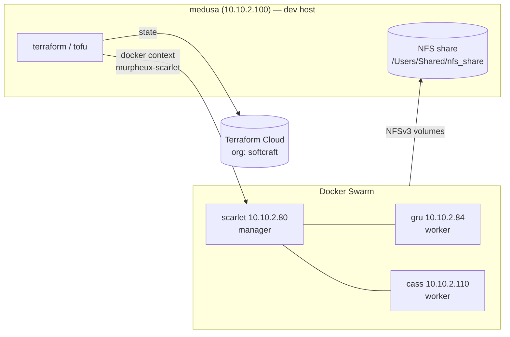

# homenet

Infrastructure-as-code for the HomeNet home lab: Terraform (`kreuzwerker/docker`) and Docker Compose deployments targeting a 3-node Docker Swarm (`scarlet` manager, `gru` / `cass` workers), backed by NFS storage on `medusa`.

Each top-level folder is an **independent deployment** with its own state, providers and lifecycle.

---

## Table of Contents

- [Architecture](#architecture)
- [Deployment Inventory](#deployment-inventory)
- [Shared Prerequisites](#shared-prerequisites)
- [Working Conventions](#working-conventions)
- [Deployments](#deployments)
  - [agentgateway](#agentgateway) · [openclaw](#openclaw) · [oclaw](#oclaw) · [database](#database) · [prometheus](#prometheus) · [elk](#elk) · [pi-hole](#pi-hole) · [tomcat](#tomcat) · [gitea](#gitea) · [ansible](#ansible) · [utils](#utils)
- [Published Port Map](#published-port-map)
- [Security Findings](#security-findings)
- [Terraform Improvement Recommendations](#terraform-improvement-recommendations)
- [Prioritised Remediation Roadmap](#prioritised-remediation-roadmap)
- [Change Log](#change-log)

---

## Architecture



---

## Deployment Inventory

| Folder | Tooling | Runtime | State backend | Services |
|---|---|---|---|---|
| [`agentgateway/`](agentgateway/) | Terraform (single file), Makefile | Swarm service | Terraform Cloud `homenet-agentgateway` | agentgateway v1.7.0 LLM/MCP gateway |
| [`openclaw/`](openclaw/) | Terraform (5 modules) | Swarm services | Terraform Cloud `homenet-openclaw` | Traefik, OpenClaw, browser sidecar, Hermes |
| [`oclaw/`](oclaw/) | Dockerfiles, Compose, GitHub Actions | Compose | n/a | OpenClaw image build pipeline + Compose run |
| [`database/`](database/) | Terraform (5 modules) | Swarm services | Terraform Cloud `homenet-database` | MySQL, MongoDB, PostgreSQL, SQL Server, Redis |
| [`prometheus/`](prometheus/) | Terraform (4 modules), Makefile | Swarm services | Terraform Cloud `homenet-prometheus` | Prometheus, Grafana, Loki (on the workers), cAdvisor (global) |
| [`elk/`](elk/) | Terraform (4 modules), Makefile | Swarm services | Terraform Cloud `homenet-elk` | Elasticsearch, Kibana, Filebeat 8.19 (security on); optional Logstash |
| [`pi-hole/`](pi-hole/) | Terraform, Makefile, scripts | Standalone containers (ipvlan) | Terraform Cloud `homenet-pihole` | Pi-hole (`dns2`), nebula-sync (`dns2` → `dns`) |
| [`tomcat/`](tomcat/) | Terraform, Makefile | Swarm service | Terraform Cloud `homenet-tomcat` | Apache Tomcat 11.0 |
| [`gitea/`](gitea/) | Docker Compose | Compose | n/a (orphan empty `terraform.tfstate`) | Gitea server, Actions runner |
| [`ansible/`](ansible/) | Ansible playbooks | Host config | n/a | Patching, SSH hardening, Pi-hole, New Relic |
| [`utils/`](utils/) | Bash, Swarm stack, Python | Mixed | n/a | Host cleanup, Swarm prune, Gmail bulk-delete CLI |

---

## Shared Prerequisites

| Requirement | Detail | Used by |
|---|---|---|
| Terraform / OpenTofu | `>= 1.15.7` where pinned (`agentgateway`, `openclaw`) | All Terraform stacks |
| Docker context | `murpheux-scarlet` must exist on the operator host (`docker context ls`) | All Terraform stacks |
| Terraform Cloud | Org `softcraft`; run `terraform login` once | agentgateway, openclaw, database, pi-hole, tomcat, prometheus, elk |
| NFS export | `10.10.2.100:/System/Volumes/Data/Users/Shared/nfs_share/docker_volumes/...` (NFSv3, `nolock,soft,resvport`) | openclaw, database, oclaw |
| Host bind paths | `/home/murpheux/HomeNet/<stack>/...` must exist on the target node | prometheus, elk, pi-hole, gitea |
| 1Password CLI | `op` signed in; every `op://` reference in the stack's env file must resolve | agentgateway, database, pi-hole, prometheus, tomcat (others still use tfvars) |
| Secrets | 1Password references in each stack's committed `op.env` (`agentgateway/`, `database/`, `elk/`, `pi-hole/`, `prometheus/`, `tomcat/`). Other stacks still use untracked `secrets.tfvars` / `backend.tfvars` | All |

### Terraform workflow

Stacks with a Makefile (`agentgateway/`, `pi-hole/`) wrap every command in `op run`, so secrets are resolved at runtime and never written to disk:

```zsh
cd ~/AI_Workspace/Projects/HomeNet/<stack> && make init && make plan
```

```zsh
make apply
```

> `make apply` runs `terraform apply -auto-approve`: **there is no confirmation prompt.** Always read `make plan` first. `make destroy` (all three Makefile stacks) keeps Terraform's `yes` prompt. In `database/` it deletes the local data volumes; `make destroy-services` keeps them. Neither Makefile saves a plan file, because a saved plan contains the secret values in plaintext.

Other stacks still use the manual workflow:

```zsh
cd ~/AI_Workspace/Projects/HomeNet/<stack>
terraform init -input=false                                      # TFC-backed stacks
terraform plan -input=false -var-file=secrets.tfvars
terraform apply -input=false -var-file=secrets.tfvars
```

> **Fresh-clone notes:**
> - `variables.tf` files are now tracked; the `**/variables.tf` ignore rule is commented out.
> - `outputs.tf` files are now tracked too (the `**/outputs.tf` rule is commented out). `**/__init__.py` is still ignored. See [T-1](#cross-cutting).
> - Some stacks need git-ignored local files before `plan` works: `agentgateway/tls/`, `agentgateway/ui.htpasswd`, and every `secrets.tfvars` / `backend.tfvars`.

---

## Working Conventions

| Topic | Convention |
|---|---|
| Secrets | Use 1Password references only. A committed env file (`pi-hole/op.env`, `database/op.env`) holds `op://` references and no values; `agentgateway/README.md` ("How a provider key reaches agentgateway") walks through the full path from `op.env` to the container; files holding values (`.env`, `*.tfvars`, `tls/`, `*.htpasswd`, `*.exclude`) are git-ignored. Run `ggshield secret scan path -r <stack>/` before committing. New generated secrets: `bash scripts/create-op-item.sh <vault> <title> <field>...`; existing tfvars: `bash scripts/import-tfvars-to-op.sh <vault> <title> <file>` |
| Checking secrets | `make check-secrets` (every Makefile stack; shared `scripts/describe-secrets.sh`) report whether each reference resolves, and its shape, without printing values |
| Image versions | Pin by release tag (`agentgateway:v1.7.0`, `nebula-sync:v0.11.3`). Bump deliberately after reading the release notes |
| Provider versions | Every root and module requires `kreuzwerker/docker` `">= 4.6.0"`. To change the minimum, edit all 24 declarations together, then run `bash scripts/upgrade-provider-locks.sh` from the repo root. That re-runs `terraform init -upgrade` in each stack and records hashes for `darwin_arm64` and `linux_amd64` |
| Timezone | Containers use `TZ=America/Edmonton`. Alberta no longer observes daylight saving, so `-06:00` timestamps year-round are correct |
| Docker commands | Run from `medusa` with `docker --context=murpheux-scarlet`. Leave `2>&1` off `docker logs`; it already prints both streams |
| Diagnosing a service | `docker service ps <svc> --no-trunc` first, then `docker service logs --since 5m <svc>` |

---

## Deployments

### agentgateway

OpenAI-compatible LLM gateway and reverse proxy ([agentgateway](https://agentgateway.dev)) with a web UI. It routes `/v1/*` requests by model-name glob to Anthropic (personal and enterprise keys), OpenAI, DeepSeek, Gemini, OpenRouter, LM Studio or local Ollama. It also offers a failover virtual model, `ha/claude-sonnet-5-5`, and proxies MCP targets. This is the `https://scarlet:9443/v1` endpoint used by AI coding agents. The full operator guide is in [`agentgateway/README.md`](agentgateway/README.md).

| Item | Value |
|---|---|
| Image | `cr.agentgateway.dev/agentgateway:v1.7.0` (pinned) |
| Swarm service | `softcraftgenia`, runs as `1000:1000`, constrained to `node.hostname == softcraftscarlet` (x86-64-v2 CPU requirement) |
| Ports | `9443` HTTPS (API + UI), `8082 → 8080` HTTP→HTTPS redirect. The only route is that redirect; the unused `/proxy` → `localhost:3000` route was removed |
| Config | `agentgateway.yaml` and `base-costs.json` in the repo, shipped as Swarm configs (no NFS mount). No plaintext secrets: gateway keys are `keyHash`, provider keys are `$VAR` references |
| Secrets | Provider keys: container env vars from `op.env` (1Password references). TLS cert/key and `ui.htpasswd`: Swarm secrets under `/run/secrets/`, created from git-ignored local files |
| Storage | No NFS. **Local** volume → `/state` (SQLite must not be on NFS) |
| Operations | `make check-secrets`, `make plan`, `make apply` (no prompt), `make reload`, `make status`, `make logs`, `make destroy` (prompts) |
| Extras | `null_resource` + `local-exec` sets ownership on the state volume; `docker/compose.yaml` is a standalone quick-start reference only |

### openclaw

Modular Terraform deployment of the [OpenClaw](https://github.com/openclaw/openclaw) AI agent platform on Swarm, behind Traefik with TLS from an internal CA that Terraform generates.

| Module | Resources | Notes |
|---|---|---|
| `modules/tls` | Root CA (RSA 4096, 10 y) + server cert (1 y) via `hashicorp/tls` | CA private key lives in TFC state |
| `modules/network` | Overlay `traefik-public` | — |
| `modules/traefik` | `traefik:v3.0` service, cert/key as `docker_secret` (content-hashed names force rotation), dynamic TLS `docker_config` | Publishes `80`/`443`, manager-only, mounts `docker.sock` (ro) |
| `modules/openclaw` | `openclaw` + `browser` sidecar services, NFS volumes for data/browser | `browser` name is hard-wired by the upstream image; Basic-Auth via Traefik middleware label |
| `modules/hermes` | `ghcr.io/nousresearch/hermes-agent` gateway, NFS volume | Publishes `8642`, `/health` healthcheck |

Root outputs: `openclaw_url`, `ca_certificate` (sensitive). Required inputs: `admin_password`, provider API keys, `openclaw_client_htpasswd`, `openclaw_gateway_token`.

### oclaw

Build-and-run tooling for the OpenClaw container images (`coollabsio/openclaw`, `-base`, `-browser`), vendored from the upstream Coolify packaging. It builds from source and adds an nginx front-end (Basic-Auth, healthcheck, hooks bypass). It also exposes a CDP browser sidecar and translates 100+ environment variables into `openclaw.json`. A full env-var reference is in [`oclaw/README.md`](oclaw/README.md).

| Component | Purpose |
|---|---|
| `Dockerfile.base` | `node:22-bookworm` multi-stage: clones `openclaw/openclaw@${OPENCLAW_GIT_REF}`, `pnpm build`, adds Linuxbrew, Go, `uv` |
| `Dockerfile` | Adds nginx + `htpasswd`, entrypoint, `HEALTHCHECK /healthz`, `EXPOSE 8080` |
| `Dockerfile.browser` | `linuxserver/chromium` + nginx Host-rewrite proxy (`9223 → 9222` CDP) |
| `docker-compose.yml` | Production run: `openclaw` (`8080`, `18789`) + `browser`; NFS-backed data volumes, local `state` volume |
| `docker-compose.local.yml` | Local images built by `scripts/build.sh`, plain local volumes |
| `scripts/` | `entrypoint.sh` (bootstrap, nginx config generation), `configure.js` (env → JSON 3-tier merge), `smoke.js`, `utils.js` + tests |
| `.github/workflows/` | `auto-update` (hourly upstream release check → multi-arch build/push to Docker Hub + GHCR), `build` (PR CI), `build-browser`, `rebuild-versions` |

> The workflows under `oclaw/.github/` **will not run** from this repo. GitHub only reads workflows from the repo-root `.github/workflows/`.

### database

Swarm database tier on a shared overlay network `db_net`, each service pinned to one node: MySQL, MongoDB and SQL Server on `softcraftscarlet`, PostgreSQL on `softcraftcassandra`, Redis on `softcraftgru`. MySQL, MongoDB, PostgreSQL and Redis keep their data on node-local volumes on their node and have no NFS mounts; SQL Server data and config are on NFS. The full operator guide, including the one-time migration steps, is in [`database/README.md`](database/README.md).

| Module | Image | Port | Password delivered as |
|---|---|---|---|
| `mysql` (`softcraftdave`) | `mysql:8.0` | `3306` | Swarm secret, via `MYSQL_ROOT_PASSWORD_FILE` |
| `mongodb` (`softcraftjerry`) | `mongo:7` | `27017` | Swarm secret, via `MONGO_INITDB_ROOT_PASSWORD_FILE` |
| `postgresql` (`softcraftmark`) | `postgres:16` | `5432` | Swarm secret, via `POSTGRES_PASSWORD_FILE` |
| `sqlserver` (`softcraftjorge`) | `mcr.microsoft.com/mssql/server:2022-latest` (`MSSQL_PID=Developer`) | `1433` | `MSSQL_SA_PASSWORD` env var (the image has no `*_FILE` option) |
| `redis` (`softcraftron`) | `redis:7-alpine` (AOF on) | `6379` | `requirepass` in a `redis.conf` Swarm secret |

| Item | Value |
|---|---|
| Credentials | 1Password item `homenet-database` (vault `private`), referenced by `database/op.env` |
| Operations | `make check-secrets`, `make plan`, `make apply` (no prompt), `make destroy-services` (keeps data), `make destroy` (deletes data; prompts) |
| Password changes | MySQL, MongoDB, PostgreSQL and SQL Server apply the password only on **first initialisation**; rotate in the database, then update 1Password. Redis applies it on every start |
| Migration | **Pending:** run `database/scripts/import-tfvars-to-op.sh`, then delete `secrets.tfvars`, `plan.tfplan` (a saved plan containing all five passwords in plaintext) and `main.tf.backup` |
| Why local data | The NFS export is `-mapall=nobody`, so the images' startup `chown` of their data directory fails and the task exits: a crash loop. `gru` and `cass` also lack the x86-64-v2 / AVX instructions `mysql:8.0` and `mongo:7` need |
| Known issues | No failover or backups for `scarlet`-local data; SQL Server data still on NFS `soft,nolock`; ports open on every node's IP (S-10); images unpinned; no healthchecks. Details in `database/README.md` |

### prometheus

Observability stack on overlay `monitoring_network`, off `scarlet`: Prometheus on `softcraftcassandra`, Grafana and Loki on `softcraftgru`, and cAdvisor `global` on every node. The full operator guide is in [`prometheus/README.md`](prometheus/README.md).

| Module | Image | Node | Port | Notes |
|---|---|---|---|---|
| `prometheus` (`softcraftbelle`) | `prom/prometheus:latest` | cass | `9090` | Config from `config/prometheus.yaml` as a Swarm config; TSDB on `prometheus_data_local`; 30 d / 10 GB retention; lifecycle API off |
| `grafana` (`softcraftbob`) | `grafana/grafana:latest` | gru | `3000` | Admin password as a Swarm secret (`__FILE`); `grafana_data_local`; Prometheus and Loki datasources |
| `loki` (`softcraftmel`) | `grafana/loki:3.0.0` | gru | `3100` | Config from `config/config.yaml` as a Swarm config; `loki_data_local` |
| `cadvisor` (`softcraftchow`) | `gcr.io/cadvisor/cadvisor:latest` | global | `8080` | Scraped per node via `tasks.softcraftchow`; host mounts read-only |

| Item | Value |
|---|---|
| State | Terraform Cloud workspace `homenet-prometheus` (Local execution); migrated from local state |
| Credentials | 1Password item `homenet-grafana`, referenced by `prometheus/op.env`. The `grafana` provider logs in with the admin credentials, so no token is needed; `backend.tfvars` and `secrets.tfvars` can go |
| Operations | `make init` (through `op run`), `make check-secrets`, `make plan`, `make apply` (no prompt), `make destroy` (deletes data; prompts) |
| Status | Not running on the Swarm before this change. First deployment steps, including optional copying of the old `scarlet` bind-mount data, are in the stack README |

### elk

Log pipeline on overlay `elk_net`, **8.19.23** with security enabled. Filebeat on every node ships container logs straight to Elasticsearch. The full operator guide is in [`elk/README.md`](elk/README.md).

| Module | Swarm name | Image | Node | Port | Notes |
|---|---|---|---|---|---|
| `elasticsearch` | `softcraftotto` (alias `elasticsearch`) | `elasticsearch:8.19.23` | scarlet | `9200` | `es_data`; `elastic` password via `ELASTIC_PASSWORD_FILE`; healthcheck + `converge_config` |
| `kibana` | `softcraftcarl` | `kibana:8.19.23` | gru | `5601` | Signs in as `kibana_system`; `kibana.yml` as a Swarm secret; `kibana_data_local` |
| `filebeat` | `softcraftphil` | `filebeat:8.19.23` | global | — | `filestream` + container parser; `filebeat_writer` user; `filebeat.yml` as a Swarm secret |
| `logstash` | `softcraftjerrry` | `logstash:8.19.23` | scarlet | — | Optional, `enable_logstash = false` |

| Item | Value |
|---|---|
| State | Terraform Cloud workspace `homenet-elk` (Local execution) |
| Credentials | 1Password item `homenet-elk`, generated by `make create-secrets`, referenced by `elk/op.env` |
| Users | `elastic/elasticstack` provider: `kibana_system` password, `filebeat_writer` role and user |
| Operations | `make create-secrets`, `make check-secrets`, `make bootstrap` (first deploy: Elasticsearch only), `make plan`, `make apply` (no prompt), `make destroy` (deletes `es_data`; prompts) |
| Upgrade | 7.17 → 8.19 upgrades `es_data` in place, irreversibly: back it up first (README step 1) |

### pi-hole

`dns2` (`10.10.2.7` / `fd00:10:10:2::5`), one of the LAN's two DNS servers and ad-blockers. It runs as a standalone `docker_container` (`softcraftjim`) on `scarlet`, on a dual-stack **ipvlan** network bound to `enp3s0f0`, so it gets its own LAN IP. The stack also runs **nebula-sync**, which copies `dns2`'s lists and DNS settings to the other DNS server, `dns` (`10.10.2.9`, a Raspberry Pi named `softcraftjon` that is outside this repo).

| Item | Value |
|---|---|
| Image | `pihole/pihole:latest` (not yet pinned) |
| Listens on | `53/tcp`, `53/udp`; web UI and API on `443` (HTTPS) and `8080` (HTTP), per `webserver.port = 8080o,443os`. **Not** port `80` |
| Storage | Bind mounts under `/home/murpheux/HomeNet/pihole/`; private in-memory `/tmp` (`tmpfs`, 256 MB, `noexec,nosuid`) |
| Capabilities | Docker defaults only. `NET_ADMIN` was removed: it's needed only for Pi-hole's DHCP server, and `router1` serves DHCP |
| Admin password | `pihole_password` from `op://private/pi-hole/password`, applied through `FTLCONF_webserver_api_password`. It overrides any password set in the UI; change it in 1Password, then `make apply` |
| 2FA | On for both Pi-holes, so unattended clients must use app passwords |
| Operations | `make check-secrets`, `make check-auth`, `make plan`, `make apply` (no prompt), `make destroy` (prompts; takes `dns2` offline) |

#### nebula-sync

| Item | Value |
|---|---|
| Image | `ghcr.io/lovelaze/nebula-sync:v0.11.3` (pinned) |
| Address | `10.10.2.201` on the same ipvlan network. An ipvlan parent host can't reach its own ipvlan children, so a bridge-networked container on `scarlet` couldn't reach `dns2` |
| Direction | Primary `https://10.10.2.7` (`dns2`) → replica `https://10.10.2.9` (`dns`), hourly (`0 * * * *`), plus once at start |
| Auth | App passwords: `op://private/pi-hole/app-password-dns2` (primary) and `op://private/pi-hole/app-password-dns` (replica). The replica needs `webserver.api.app_sudo = true` |
| Mode | **Selective**, not `FULL_SYNC`. A Teleporter import can carry `webserver.api` (admin password, 2FA secret, app password, `app_sudo`) and break the replica's login. Selective sync has no web-server section, so each Pi-hole keeps its own credentials |
| Synced | Groups, ad lists, allow/deny lists, clients (each including group assignments), DNS settings except `interface` and `listeningMode` (container-specific on `dns2`), resolver settings; gravity is rebuilt on the replica |
| Not synced | DHCP config and leases, NTP, database, misc and debug settings, web-server/API settings |
| TLS | `CLIENT_SKIP_TLS_VERIFICATION=true`, because both Pi-holes use self-signed certs. Remove it once they serve certs from an internal CA |

Check that both app passwords work before an apply; the check logs out again, so it doesn't use up API sessions:

```zsh
cd ~/AI_Workspace/Projects/HomeNet/pi-hole && make check-auth
```

Check sync health:

```zsh
docker --context=murpheux-scarlet logs --tail 40 nebula-sync
```

```zsh
docker --context=murpheux-scarlet inspect nebula-sync --format 'status={{.State.Status}} restarts={{.RestartCount}}'
```

| Symptom | Cause |
|---|---|
| `connection refused` on `:80` / `:443` | Wrong port, or `dns2` restarting. The API listens on `443` / `8080` only |
| `No 2FA token found in JSON payload` | Logging in with the admin password; use an app password |
| `app-password` / `password incorrect` | 1Password field doesn't match the active app password. Pi-hole generates a new one each time the dialog opens; it only takes effect after **Enable new app password** |
| Replica rejects writes | `webserver.api.app_sudo` is `false` on `dns` |

### tomcat

Apache Tomcat 11.0 (`tomcat:11.0.27-jre21-temurin-noble`, an exact patch tag) as a Swarm service on a worker node. `server.xml`, `index.html` and a `/ping` health page are rendered with `templatefile()` and shipped as `docker_config`s; `application.properties`, which holds the DB password, ships as a `docker_secret`. The full operator guide is in [`tomcat/README.md`](tomcat/README.md).

| Item | Value |
|---|---|
| Ports | `8085` (app), `8081` (health). Moved off `8080` (cAdvisor) |
| Network | Joins `db_net`; JDBC URL `jdbc:postgresql://softcraftmark:5432/appdb` |
| Credentials | `app_db_password` from 1Password `homenet-tomcat` via `tomcat/op.env`; `make create-secret` generates it, `make db-role` creates the PostgreSQL role |
| State | Terraform Cloud workspace `homenet-tomcat` (was local; the old state was empty) |
| Operations | `make create-secret`, `make check-secrets`, `make db-role`, `make plan`, `make apply` (no prompt), `make destroy` (prompts) |

### gitea

Self-hosted Git server with a Gitea Actions runner, run with Docker Compose rather than Terraform.

| Service | Image | Ports | Notes |
|---|---|---|---|
| `server` | `docker.gitea.com/gitea:1.26.2-rootless` | `3002 → 3000` (web), `2222` (SSH) | Bind mounts under `/home/murpheux/HomeNet/gitea/server/` |
| `runners` | `gitea/runner:latest` | — | Registration via `.env`; mounts `docker.sock`; config `config/config.yaml` (`config-alt.yaml` is the unused stock reference) |

```zsh
docker --context=scarlet-daemon compose -f gitea/docker-compose.yml up -d
```

### ansible

Standalone playbooks with no committed inventory, `ansible.cfg` or `requirements.yml`. Groups `servers` and `pihole_hosts` must be supplied with `-i`.

| Playbook | Purpose |
|---|---|
| `ping.yaml` | Connectivity check |
| `ssh.yaml` | Install/harden `sshd` (pubkey only) |
| `system_update.yaml`, `update_upgrade_linux.yaml` | Cross-distro patching (apt / pacman / dnf / apk) |
| `nginx.yaml` | Nginx smoke-test page (apt only) |
| `pihole.yaml` | Pi-hole install via `HomeSecExplorer.pihole` role |
| `newrelic/*` | Six overlapping New Relic agent install variants |
| `pihole-update.yaml` | Empty |

### utils

| Path | Purpose |
|---|---|
| `bash/cleanup.sh` | macOS/Linux cache and log purge. **Destructive** (wipes Keychains/Preferences); broken shebang (`!/bin/bash`) |
| `docker/swarm-cleaner.yml` + `deploy.sh` | One-shot `global` stack running `docker system prune -f` on every node via `docker.sock` |
| `python/gmail-del/` | Poetry CLI to bulk-delete old Gmail messages (Gmail API OAuth or IMAP) |

---

## Published Port Map

All Swarm services below use `publish_mode = "ingress"`, so each port is bound on **every** node in the routing mesh.

| Port | Stack → service | Conflict |
|---|---|---|
| `80` | openclaw/traefik | — (agentgateway's redirect moved to `8082`) |
| `443` | openclaw/traefik | — |
| `1433` / `3306` / `5432` / `6379` / `27017` | database | — |
| `2222`, `3002` | gitea (Compose) | — |
| `3000` | prometheus/grafana | — |
| `3100` | prometheus/loki | — |
| `5601` / `9200` | elk | — |
| `8080` | prometheus/cadvisor (global) **and** oclaw (Compose) | ⚠️ Collision only if `oclaw` runs on a Swarm node; tomcat moved to `8085` |
| `8085` | tomcat | — |
| `8081` | tomcat health | — |
| `8082` | agentgateway (HTTP → HTTPS redirect) | — |
| `8642` | openclaw/hermes | — |
| `9090` | prometheus | — |
| `9443` | agentgateway (HTTPS: LLM API, UI, MCP) | — |
| `18789` | oclaw gateway (Compose) | — |

### Dedicated LAN addresses (ipvlan, not on the Swarm ingress)

| Address | Container | Listens on |
|---|---|---|
| `10.10.2.7` / `fd00:10:10:2::5` | `softcraftjim` (Pi-hole `dns2`) | `53/tcp+udp`, `443` (HTTPS UI/API), `8080` (HTTP UI/API) |
| `10.10.2.201` | `nebula-sync` | nothing; outbound only |

Both share `scarlet`'s MAC address (`ipvlan` L2 mode), so two IPs with the same MAC in an ARP table is expected, not a conflict.

---

## Security Findings

Values are intentionally omitted. Locations only. Status as of 2026-11-04.

### Critical: act before the next `git push`

| ID | Location | Issue | Status / remaining action |
|---|---|---|---|
| S-1 | `agentgateway/agentgateway.yaml` | Plaintext gateway bearer API key | ⚠️ **Partly fixed.** The working tree uses `keyHash`, and `keep/` and `agentgateway.exclude` are gone. Still to do: the key is in local commits **`334af42` and `f25106c`** on `dev` (not on `origin`), so clean them before pushing `dev`, e.g. `git filter-repo --path agentgateway/agentgateway.yaml --invert-paths --refs main..dev`, then recommit. Rotate the key (it also sat in world-readable NFS files), delete `agentgateway/*.bak` and the NFS `agentgateway.yaml.bak-*` copies |
| S-2 | `ansible/newrelic/install-local.yaml` | New Relic API key + account ID **committed** (local `main`/`dev` and stashes; not on `origin`) | ❌ Open. Rotate, move to Ansible Vault or an `op` lookup, rewrite local history before pushing |
| S-3 | `ansible/pihole.yaml` | Pi-hole admin password **committed** | ❌ Open. Same as S-2 |
| S-4 | `oclaw/.env_old` | Live API key and a dictionary-word gateway token; **not** matched by `.gitignore` (`.env` only) | ❌ Open. Delete the file, rotate both, add `.env*` / `!.env.example` to `.gitignore` |

### High

| ID | Location | Issue | Status |
|---|---|---|---|
| S-5 | `openclaw/modules/openclaw/main.tf`, `modules/hermes/main.tf` | Provider API keys passed as plain service **env vars** while matching `docker_secret`s exist but go unused, so keys show in `docker service inspect` | ❌ Open |
| S-6 | `openclaw/modules/openclaw/main.tf` | Traefik Basic-Auth htpasswd passed as a service label (visible via inspect) | ❌ Open |
| S-7 | `tomcat/variables.tf` | Hardcoded DB password as a variable `default`, rendered into a `docker_config` (not encrypted like `docker_secret`) | ⚠️ Fixed in code: no default, the password comes from 1Password (`homenet-tomcat`, generated by `make create-secret`) and `application.properties` ships as a Swarm **secret**. The old default is still in `a1ef232` (local only): include `tomcat/variables.tf` in the S-1 history rewrite before pushing |
| S-8 | `prometheus/keep.bak` | Weak hardcoded defaults on `sensitive` variables (stale file, still on disk) | ❌ Open: delete `prometheus/keep.bak` (git-ignored, on disk only). Also delete `backend.tfvars` and `secrets.tfvars` once the 1Password import is done |
| S-9 | `elk/modules/elasticsearch` | `xpack.security.enabled=false` while `9200` is published on every node | ⚠️ Fixed in code (not yet deployed): security on, `elastic`/`kibana_system`/`filebeat_writer` passwords from 1Password; HTTP still plain on the LAN |
| S-10 | `database/*` | Five DB ports ingress-published on every node; NFSv3 `nolock` volumes with no auth beyond IP/UID trust | ❌ Open; needs a decision about clients (see `database/README.md`). Related, fixed in code (not yet applied): MySQL, MongoDB, PostgreSQL and Redis passwords no longer show in `docker service inspect` |
| S-16 | `database/plan.tfplan` | A saved plan from June containing all five database passwords in plaintext (git-ignored, but on disk) | ❌ Delete it once the migration is applied |
| S-11 | `gitea/config/config.yaml` | Runner `valid_volumes: ["**"]` + `docker.sock` mount, so any workflow author effectively gets root on the host | ❌ Open |
| S-12 | `pi-hole/main.tf` | Host `/tmp:/tmp` bind mount on a `NET_ADMIN` container | ✅ Fixed: private `tmpfs` `/tmp`, `NET_ADMIN` removed |
| S-13 | `openclaw/modules/tls/outputs.tf` | `server_key` output not marked `sensitive` | ❌ Open |
| S-14 | NFS `docker_volumes/agentgw/` | TLS key, `ui.htpasswd` (bcrypt cost 5) and its backup were world-readable; `agentgateway.yaml` is world-writable (`777`) | ✅ Fixed: TLS key and `ui.htpasswd` are Swarm secrets, and `agentgateway.yaml` / `base-costs.json` are Swarm configs, so agentgateway no longer reads the share. Remaining: delete the old copies there (`tls/`, `ui.htpasswd*`, `agentgateway.yaml*`, `base-costs.json`) |
| S-15 | Credentials exposed during the 2026-11 work | The LM Studio API key was shown in a tool session; the `claude-enterprise` key and the gateway key sat in world-readable NFS files | ❌ Rotate all three |

### Medium / hygiene

- `docker.sock` mounted by Traefik, cAdvisor, Filebeat, gitea runner and swarm-cleaner. Consider [`tecnativa/docker-socket-proxy`](https://github.com/Tecnativa/docker-socket-proxy) with least-privilege API filters.
- The Root CA private key lives in Terraform Cloud state (`openclaw/modules/tls`). Restrict workspace access, or issue certs outside Terraform. Likewise, agentgateway's TLS key and htpasswd are now in `homenet-agentgateway` state.
- `utils/python/gmail-del` loads `token.pickle` with `pickle.load()`. Prefer `Credentials.from_authorized_user_file()` (JSON).
- Leftover plaintext `secrets.tfvars` / `backend.tfvars` on disk in `prometheus/` and `elk/` (git-ignored, no longer used by either stack): delete them.
- `database/` NFS volumes are mounted `soft`: an NFS timeout returns I/O errors to MySQL, PostgreSQL and MongoDB, which can corrupt their data files. Switch to `hard` in a maintenance window (see `database/README.md`).
- nebula-sync skips TLS verification (`CLIENT_SKIP_TLS_VERIFICATION=true`) because both Pi-holes use self-signed certs. The traffic is encrypted, but an attacker on the LAN could impersonate a Pi-hole. Issue both certs from an internal CA.
- **A hung NFS mount can wedge Docker on a node.** agentgateway's task sat in `Starting` and couldn't be stopped while its `/config` came from the share; its config is now a Swarm config. SQL Server (`database/`) and `openclaw/` still mount the share. If a task there sticks in `Starting`, check `nfsd` on `medusa` and `mount -t nfs` on the node (`umount -f -l` releases a hung mount).
- `dns` (`softcraftjon`, Raspberry Pi) runs kernel `6.1.21-v8+` (April 2023) and an OpenSSH without post-quantum key exchange. Run `sudo apt update && sudo apt full-upgrade`; `dns2` keeps resolving during the reboot.

---

## Terraform Improvement Recommendations

### Cross-cutting

| ID | Recommendation | Why |
|---|---|---|
| **T-1** | **Remove `**/variables.tf` and `**/outputs.tf` from `.gitignore`**; also remove `**/__init__.py`. Commit variable declarations with **no secret defaults** | Reproducibility is currently broken: no stack with inputs can be planned from a clone. Ignoring declarations is the wrong way to hide secrets; S-7 shows the default-value pattern it was masking |
| **T-2** | **Standardise on one state backend.** Move `prometheus`, `elk` (MinIO) and `tomcat` (local) to Terraform Cloud, or move everything to MinIO with `use_lockfile = true` and `encrypt = true` | Three backend styles today. MinIO backends run over plain HTTP with `encrypt` commented out, and the observability state lives on the cluster it manages (chicken-and-egg during outages) |
| **T-3** | **Delete `terraform {}` / `backend` blocks from child modules** (`prometheus/modules/*`, `elk/modules/*`, `database/modules/*`). Keep only `required_providers` | Terraform ignores backend blocks in non-root modules (with a warning). They're dead, drift-prone copy-paste |
| **T-4** | **Inject secrets at runtime, never via tfvars on disk.** Use `TF_VAR_*` from `op run --env-file=.env.tpl` with `op://` references, or the `1Password/onepassword` provider data sources | Removes every plaintext `secrets.tfvars`/`backend.tfvars` |
| **T-5** | **Use `docker_secret` end-to-end** for every credential (DB passwords, API keys, htpasswd, gateway tokens) and consume them via `*_FILE` env vars (`MYSQL_ROOT_PASSWORD_FILE`, `POSTGRES_PASSWORD_FILE`, `MONGO_INITDB_ROOT_PASSWORD_FILE`, …) | Swarm secrets are encrypted in Raft and kept out of `docker inspect`. Fixes S-5, S-6, S-7 |
| **T-6** | **Pin everything.** `required_version` in every root (commented out in `database/`, `tomcat/`); provider constraints `~> 4.4` rather than `>= 4.0.0`; images by version tag + digest (`@sha256:…`) instead of `:latest` / `-latest` | `openclaw`, `prometheus`, `pi-hole`, `sqlserver`, `gitea` runner, `swarm-cleaner` all float |
| **T-7** | **Create a shared `modules/homelab-common`** (or `locals` via a `terraform_remote_state` / TFC output) exposing `nfs_server`, `nfs_base_path`, `nfs_mount_opts`, `docker_context`, node hostnames and the `nfs_volume` pattern | `10.10.2.100` and the NFS path/options are duplicated across `agentgateway`, `openclaw`, `database` (×10), `oclaw`. `murpheux-scarlet` is hardcoded in every `providers.tf` |
| **T-8** | **Parameterise the Docker context** (`var.docker_context` or `DOCKER_CONTEXT` env) and reconcile it with the documented `<host>-daemon` naming convention | Lets CI or another operator target the cluster |
| **T-9** | **Add `validation {}` blocks**: password length/complexity (`sqlserver_sa_password` documents rules but doesn't enforce them), port ranges, non-empty `domain_name`, IP/CIDR format for NFS | Fail at `plan`, not at container start |
| **T-10** | **Add `description` + `sensitive = true` to all module variables** (`openclaw/modules/*/variables.tf` are bare `type = string`) | Module-level re-declarations without `sensitive` can leak values in plan output |
| **T-11** | **Define useful outputs** (service names, endpoints, published ports, network IDs) for every stack. `database/outputs.tf` is empty; `prometheus`, `elk`, `pi-hole`, `agentgateway` have none | Smoke tests and cross-stack wiring |
| **T-12** | **Resolve ingress port collisions** (`80`, `8080`). Route HTTP services through a single Traefik (already in `openclaw`) via labels instead of publishing ports; use `publish_mode = "host"` + placement for node-local services | Today the second stack to apply fails |
| **T-13** | **Add a root `Makefile`** with `fmt`, `validate`, `lint` (`tflint`), `scan` (`checkov`/`trivy config`, `ggshield secret scan path -r .`), `plan STACK=…`, `apply STACK=…` targets, and a repo-root `.github/workflows/terraform-ci.yml` running `fmt -check`/`validate`/`tflint`/`trivy` per changed stack | No CI or lint exists for any Terraform today |
| **T-14** | **Add `pre-commit`** with `terraform_fmt`, `terraform_validate`, `terraform_tflint`, `ggshield` | Catches S-1 class issues before staging |
| **T-15** | **Replace `local-exec` provisioners** (`agentgateway` `null_resource` chown) with an init container / entrypoint or `docker_container` one-shot inside Terraform | Ties `apply` to the operator's local Docker CLI |
| **T-16** | **Add Swarm health and resilience settings** consistently: `healthcheck`, `update_config` (`order = "start-first"`, `failure_action = "rollback"`), `rollback_config`, `resources.limits`/`reservation` (only `elk` sets limits) | Safer rolling updates |
| **T-17** | **Remove clutter** from the working tree: `*.bak`, `main.tf.backup`, `keep.bak`, `agentgateway/keep/`, `openclaw/errored.tfstate`, `tomcat/templates/server.xml.old*`, `tomcat/chat.json`, `gitea/terraform.tfstate`, empty `ansible/pihole-update.yaml`, empty `utils/.../delete_old_emails_rate_limited.py` | Secret sprawl and confusion over which file is authoritative |

#### Progress (2026-11-04)

| ID | Status |
|---|---|
| T-1 | ⚠️ Mostly done: `**/variables.tf` and `**/outputs.tf` are no longer ignored, so both can be committed. `**/__init__.py` is still ignored |
| T-2 | ✅ Done in code: every Terraform stack (agentgateway, database, elk, openclaw, pi-hole, prometheus, tomcat) uses Terraform Cloud. No stack keeps state in MinIO or locally |
| T-4 | ⚠️ Done for `pi-hole/` and `agentgateway/` (`op.env`); `database/` ready (`op.env`, plus an import script). `prometheus/` (MinIO keys as `AWS_*`, Grafana secrets) and `tomcat/` ready in code; shared `scripts/import-tfvars-to-op.sh` moves any `*.tfvars` into an item. `elk/` too (generated by `scripts/create-op-item.sh`). Remaining: `openclaw/` |
| T-5 | ⚠️ Done for agentgateway's TLS cert/key and `ui.htpasswd`, and for the MySQL, MongoDB, PostgreSQL and Redis passwords. Also Grafana's admin password (`__FILE`) and Tomcat's `application.properties`. The SQL Server SA password, agentgateway's provider keys and the other stacks' credentials are still env vars |
| T-7 | ⚠️ `database/` NFS settings are now `locals` with one `for_each` volume resource. No shared module across stacks yet |
| T-6 | ⚠️ `agentgateway:v1.7.0` and `nebula-sync:v0.11.3` pinned by tag. Still `:latest`: `pihole/pihole`, `openclaw`, `openclaw-browser`, `hermes-agent`, `grafana`, `prometheus`, `cadvisor`. No digests yet. `kreuzwerker/docker` requires `>= 4.6.0` in all 24 declarations (was `>= 4.0.0`, resolving to 4.4.0, 4.5.0 or 4.6.0 depending on the stack) |
| T-9 | ⚠️ Validation added to `pi-hole` (non-empty passwords, no `\|` or `,` in app passwords) and `database` (password lengths, SQL Server complexity, Redis-safe characters, identifier rules). Two agentgateway keys have no default, so a missing reference fails at `plan` |
| T-12 | ⚠️ `8080` fixed in code: tomcat moved to `8085`. `80` fixed: agentgateway's redirect moved to `8082` (2026-11-05). Routing through a single Traefik is still open |
| T-6 (cont.) | `database/` restores `required_version = ">= 1.15.7"`. `scripts/upgrade-provider-locks.sh` refreshes every lock file. `**/.terraform.lock.hcl` is still git-ignored repo-wide, so provider versions aren't locked across machines; remove that rule and commit the lock files |
| T-13 | ⚠️ Per-stack Makefiles in `agentgateway/`, `database/` and `pi-hole/`, `prometheus/`, `tomcat/`, `elk/`; shared `scripts/describe-secrets.sh`. No root Makefile or CI yet |
| T-17 | ⚠️ Removed: `agentgateway/keep/`, `agentgateway.exclude`, `pi-hole/secrets.tfvars`. Remaining: `agentgateway/*.bak`, `prometheus/keep.bak`, `database/main.tf.backup`, `database/plan.tfplan`, `database/secrets.tfvars` (after migration), `openclaw/errored.tfstate`, `tomcat/chat.json`, `gitea/terraform.tfstate`, `ansible/pihole-update.yaml` |
| Others | ❌ Not started |

### Per stack

| Stack | Recommendations |
|---|---|
| `agentgateway` | ✅ Done: v1.7.0, `keyHash` for the gateway key, the enterprise and LM Studio keys moved to env, `ollama_api_key` dropped, TLS key and htpasswd as Swarm secrets, Makefile with `op run`. Remaining: finish S-1 (history, rotation, `.bak` files) and S-14 (remove NFS copies); add outputs; pin the image by digest; add `update_config` rollback and a healthcheck (T-16); replace the `local-exec` chown (T-15); verify the OpenRouter fallback model ID; narrow the response `reject` guardrail (blocks `kill -9`); confirm or remove the stdio MCP targets |
| `openclaw` | Pin `openclaw`, `openclaw-browser`, `hermes-agent` versions; wire existing `docker_secret`s via `*_FILE` and drop env-var duplicates (S-5); move htpasswd to a Traefik file provider backed by a secret (S-6); mark `server_key` sensitive (S-13); add a `README.md` covering CA trust distribution and htpasswd generation |
| `database` | ✅ Done in code (apply pending): 1Password `op.env`, Makefile and import script; Swarm secrets for MySQL, MongoDB, PostgreSQL and Redis; validation; `for_each` volumes; `required_version` restored. Crash loops fixed: all services pinned to `scarlet`, and MySQL, MongoDB, PostgreSQL and Redis data moved off the `-mapall=nobody` NFS export to local volumes. Remaining: run the migration, then delete `secrets.tfvars`, `plan.tfplan` and `main.tf.backup`; move SQL Server data off NFS; add backups for the `scarlet`-local data; decide on port exposure (S-10); pin images to the digests Swarm is running now; add healthchecks and `update_config` rollback; SQL Server SA password still an env var |
| `prometheus` | ✅ Done in code (not yet deployed): network-ID fix; child-module backend blocks removed (T-3); secrets from 1Password (Grafana via `__FILE`); Terraform Cloud backend; admin email out of git; configs as Swarm configs; Prometheus on cass and Grafana/Loki on gru with node-local volumes; cAdvisor global, scraped per node; lifecycle API off; Loki datasource; scrape-label fixes; Makefile; `prometheus/README.md`. Remaining: pin images to digests; Prometheus basic auth; delete `keep.bak`, `backend.tfvars`, `secrets.tfvars` |
| `elk` | ✅ Done in code (not yet deployed): 8.19.23 with security; `kibana_system` and `filebeat_writer` via the `elasticstack` provider; configs as Swarm secrets; `elasticsearch` alias fixes Kibana and Filebeat name resolution; Filebeat as root, `filestream`; Kibana on gru; Logstash optional; network-ID fix; child-module backends removed; Terraform Cloud `homenet-elk`; Makefile; `elk/README.md`. Remaining: TLS on 9200/5601; snapshot repository/backups; delete `backend.tfvars` |
| `pi-hole` | ✅ Done: password from 1Password, env-block formatting fixed, `/tmp` and `NET_ADMIN` removed, nebula-sync (selective, app passwords, HTTPS, pinned), Makefile and check scripts. Remaining: pin `pihole/pihole`; parameterise the NIC (`enp3s0f0`), subnets and IPs; add outputs (IP, admin URL); serve CA-issued certs on both Pi-holes and drop `CLIENT_SKIP_TLS_VERIFICATION`; patch `softcraftjon`; consider managing `dns` (`10.10.2.9`) from code too |
| `tomcat` | ✅ Done in code (not yet deployed): `templatefile()` (fixes `init` on arm64); password from 1Password with no default; `application.properties` as a Swarm secret; Terraform Cloud backend; port `8085`; joins `db_net` with the corrected JDBC host `postgresql`; runs on a worker; validation; `make db-role`; `tomcat/README.md`. Remaining: `git rm` `chat.json` and `templates/server.xml.old*`; delete the old local `terraform.tfstate*` after migrating; add a healthcheck |
| `gitea` | Pin runner image; restrict `valid_volumes` to an explicit allowlist; consider a rootless DinD sidecar instead of the host socket; either Terraform it like the other stacks or delete the orphan `terraform.tfstate` |
| `oclaw` | Move workflows to repo-root `.github/workflows/` (path-filtered) or into their own repo; pin `:latest` images; fix README drift (cron is hourly, not 6 h; `nginx/default.conf` doesn't exist); add a non-root `USER` for the gateway process; reconsider `BROWSER_EVALUATE_ENABLED=true` in production |
| `ansible` | Add `inventory/hosts.yml`, `ansible.cfg`, `requirements.yml`; consolidate the six New Relic playbooks into one role; move secrets to Ansible Vault or the `community.general.onepassword` lookup; replace `curl \| bash` installs |
| `utils` | Fix `cleanup.sh` shebang, add OS detection and a `--dry-run` / confirmation gate, and remove Keychain deletion; pin `alpine` in `swarm-cleaner.yml` |

---

## Prioritised Remediation Roadmap

1. **Stop secret leakage before pushing `dev`:** finish S-1 (rewrite `334af42`/`f25106c`, rotate the gateway key), S-2, S-3, S-4, S-7 (history) and S-15 (rotations). Tighten `.gitignore` (`.env*` with `!.env.example`).
2. **Restore reproducibility:** finish T-1 (un-ignore `outputs.tf` and `__init__.py`), T-17 (remaining clutter), commit `*.tfvars.example` templates.
3. **Secrets architecture:** run the `database/` migration (import, apply, delete `secrets.tfvars` and `plan.tfplan`), then apply the same pattern (`op run` Makefile, Swarm secrets) to `openclaw`, `tomcat`, `prometheus` and `elk`.
4. **State and backend consolidation:** T-2, T-3, T-6.
5. **Fix runtime defects:** port collisions (T-12), `tomcat` arm64 init failure, `elk` Filebeat path, `prometheus` web-config wiring.
6. **Shared module + CI:** T-7, T-8, T-13 (root Makefile + CI), T-14.
7. **Hardening:** S-9 → S-11, S-14, internal CA for the Pi-holes, `softcraftjon` patching, socket proxy, T-16 resilience settings.

---

## Change Log

### 2026-11-05: tomcat, prometheus

| Area | Change |
|---|---|
| `agentgateway/` | HTTPS moved `4000` → `9443`; HTTP redirect published on `8082` instead of `80` (frees `80` for openclaw's Traefik; `8081` is tomcat's health port); the dead `/proxy` → `localhost:3000` route removed. Clients must change their base URL to `https://scarlet:9443/v1` |
| `elk/` | Upgraded 7.17.18 → 8.19.23 with security: passwords from 1Password (`homenet-elk`), `kibana_system` / `filebeat_writer` via the `elasticstack` provider, `kibana.yml` / `filebeat.yml` as Swarm secrets, `elasticsearch` network alias, Filebeat `filestream` as root, Kibana to gru, Logstash optional. State to Terraform Cloud `homenet-elk` (the `cloud` block wrongly named `homenet-prometheus` was fixed). Makefile with `create-secrets` and `bootstrap`; `elk/README.md` |
| `scripts/` | `create-op-item.sh`: creates a 1Password item with generated secrets (stdin only) |
| `database/` service names | `softcraftdave` (MySQL), `softcraftjerry` (MongoDB), `softcraftmark` (PostgreSQL), `softcraftjorge` (SQL Server), `softcraftron` (Redis; `softcraftcarl` is ELK's Kibana). Old names kept as `db_net` aliases; Tomcat's JDBC URL uses `softcraftmark` |
| `tomcat/` | Rebuilt: `templatefile()`, 1Password password as a Swarm secret, Terraform Cloud backend, port `8085`, `db_net` + JDBC host fix, worker placement, Makefile (`create-secret`, `db-role`), `tomcat/README.md` |
| `prometheus/` | Rebuilt: state moved to Terraform Cloud (`homenet-prometheus`), secrets from 1Password, Grafana provider uses admin basic auth (no token), `converge_config` waits for Grafana, configs as Swarm configs, Prometheus to cass and Grafana/Loki to gru on local volumes, cAdvisor global, lifecycle API off, Loki datasource, network-ID fix, child-module backends removed, scrape-config fixes, Makefile, `prometheus/README.md` |
| `scripts/` | `import-tfvars-to-op.sh`: generic `*.tfvars` → 1Password item import (stdin only) |
| `.gitignore` | `**/outputs.tf` rule commented out, so outputs files are committed (fixes fresh clones of `openclaw/`, `tomcat/`, `prometheus/`) |

### 2026-11-04: database

| Area | Change |
|---|---|
| Providers | `kreuzwerker/docker` minimum raised to `>= 4.6.0` everywhere (24 declarations; the 4 `openclaw` module blocks had no version); new `scripts/upgrade-provider-locks.sh` rewrites each stack's lock file, fixing the checksum-mismatch error from `terraform validate` |
| `database/` | Secrets moved to 1Password (`op.env`, `scripts/import-tfvars-to-op.sh`); MySQL, MongoDB, PostgreSQL and Redis passwords delivered as Swarm secrets; validation on every input; ten volume blocks collapsed into one `for_each` with `moved` blocks; `required_version` restored; Makefile; new `database/README.md` |
| `agentgateway/` | Config moved off NFS: `agentgateway.yaml` and `base-costs.json` as Swarm configs. A hanging NFS mount had left the task stuck in `Starting`. `sync-config` removed; restart policy 10 s; `make status` / `make logs` |
| `agentgateway/` secrets file | `.env` renamed `op.env` and committed (references only); `make check-env` replaced by `make check-secrets` (`scripts/describe-secrets.sh`), like the other stacks |
| `database/` placement | PostgreSQL moved to `softcraftcassandra` and Redis to `softcraftgru` to take load off `scarlet` (`local.db_nodes`). Their volumes are created through new `docker.cass` / `docker.gru` provider aliases. MySQL and MongoDB stay on `scarlet` (CPU), SQL Server too (NFS data) |
| `database/` plan | Every plan replaced all five services because `networks_advanced.id` was given the network name (`db_net`) instead of its ID; now `docker_network.db_net.id` |
| `database/` stability | Fixed crash loops: all five services pinned to `softcraftscarlet` (`gru`/`cass` can't run `mysql:8.0` or `mongo:7`), and MySQL, MongoDB, PostgreSQL and Redis data moved to local volumes (their `chown` fails on the `-mapall=nobody` export). Their empty NFS config mounts were removed too, because Docker's permission copy onto them was refused and the tasks were rejected. Restart delay 10 s |
| `scripts/` | `describe-secrets.sh` moved from `pi-hole/scripts/` to the repo root and shared by `pi-hole/` and `database/` |

### 2026-11-02 → 2026-11-04

| Area | Change |
|---|---|
| Docs | This README written: inventory, prerequisites, findings and recommendations. `agentgateway/README.md` rewritten for v1.7.0 and Swarm secrets |
| `.gitignore` | `**/variables.tf` rule commented out (all `variables.tf` now tracked); added `**/*.exclude`, `**/tls`, `**/*.htpasswd` |
| `pi-hole/` | Password moved from `secrets.tfvars` to 1Password (`op.env`); `env` block fixed (entries with spaces around `=` were reaching Pi-hole with garbled names); host `/tmp` bind replaced by `tmpfs`; `NET_ADMIN` removed; Makefile (`check-secrets`, `check-auth`, `plan`, `apply -auto-approve`); `scripts/check-pihole-auth.sh`, `scripts/describe-secrets.sh` |
| `pi-hole/` nebula-sync | New `nebula_sync.tf`: `dns2` → `dns`, HTTPS, app passwords (2FA is on), selective sync, pinned `v0.11.3` |
| `agentgateway/` | Upgraded v1.5.0 → v1.7.0. Config ported with no plaintext secrets (`keyHash`, `$CLAUDE_ENTERPRISE_API_KEY`, `$LM_STUDIO_API_KEY`); guardrail `scope` pinned; `'*'` wildcard moved last; `ha/claude-sonnet-5-5` failover added. TLS cert/key and `ui.htpasswd` moved to Swarm secrets. Makefile (`check-env`, `plan`, `apply -auto-approve`, `sync-config`, `reload`) |

---

## License

[MIT](LICENSE)
