# Agent Gateway

OpenAI-compatible LLM gateway and reverse proxy ([agentgateway](https://agentgateway.dev)) for the AI coding agents on the home LAN, running as the Swarm service `softcraftgenia` on `scarlet`.

| Item | Value |
|---|---|
| Image | `cr.agentgateway.dev/agentgateway:v1.7.0` |
| Endpoints | `https://scarlet:9443/v1` (LLM API), `https://scarlet:9443/ui` (dashboard), `http://scarlet:8082/` → 301 to HTTPS |
| Config | `agentgateway.yaml` and `base-costs.json` (this repo) → Swarm configs mounted read-only at `/config/` |
| TLS cert/key, UI htpasswd | Swarm secrets, created by Terraform from git-ignored local files |
| Provider API keys | Container env vars, resolved from 1Password at apply time |
| State | SQLite on the node-local `agentgateway_state` volume |
| Terraform state | Terraform Cloud, org `softcraft`, workspace `homenet-agentgateway` |

## Files

| Path | Tracked | Purpose |
|---|---|---|
| `main.tf` | yes | Volumes, Swarm secrets, service |
| `agentgateway.yaml` | yes | Gateway config. No plaintext secrets: provider keys are `$VAR` references, gateway keys are `keyHash` |
| `base-costs.json` | yes | Model price catalog (`config.modelCatalog`) |
| `Makefile` | yes | `plan` / `apply` / `reload` / `status` / `logs` wrappers |
| `op.env` | yes | `TF_VAR_*=op://…` 1Password references only (no values), the same format as the other stacks |
| `tls/cert.pem`, `tls/key.pem` | no (`**/tls`) | Source for the TLS secrets |
| `ui.htpasswd` | no (`**/*.htpasswd`) | Source for the UI basic-auth secret |
| `docker/compose.yaml` | yes | Standalone quick-start reference; not used by the Swarm deploy |

A fresh clone can't `plan` until `tls/` and `ui.htpasswd` exist locally (both git-ignored).

## Prerequisites

- Docker context `murpheux-scarlet`, and `terraform login` for Terraform Cloud.
- 1Password CLI (`op`) signed in, with every reference in `op.env` resolvable. Check with `make check-secrets`.

### CPU constraint

The upstream image is a Chainguard `glibc-dynamic` build that requires the **x86-64-v2** microarchitecture (SSE4.2 + POPCNT). The service is pinned to `softcraftscarlet` (Haswell, x86-64-v3). `softcraftgru` (Core 2 Duo P8800) and `softcraftcassandra` can't run it; tasks scheduled there abort with `Fatal glibc error: CPU does not support x86-64-v2` (exit 127).

> If `cass` gets x86-64-v2 hardware, replace the hostname constraint in `main.tf` with a node label (`node.labels.cpu.arch == x86-64-v2`) and label each compatible node with `docker node update --label-add cpu.arch=x86-64-v2 <node>`.

## Credentials

### `op.env` (1Password references)

| `TF_VAR_*` in `op.env` | Container env | Used by |
|---|---|---|
| `TF_VAR_anthropic_api_key` | `ANTHROPIC_API_KEY` | `anthropic` provider |
| `TF_VAR_claude_enterprise_api_key` | `CLAUDE_ENTERPRISE_API_KEY` | `claude-enterprise` provider (no default: `plan` fails if unresolved) |
| `TF_VAR_deepseek_api_key` | `DEEPSEEK_API_KEY` | `deepseek` provider |
| `TF_VAR_openai_api_key` | `OPENAI_API_KEY` | `openai` provider |
| `TF_VAR_openrouter_api_key` | `OPENROUTER_API_KEY` | `openrouter` provider |
| `TF_VAR_gemini_api_key` | `GEMINI_API_KEY` | `gemini` provider |
| `TF_VAR_lm_studio_api_key` | `LM_STUDIO_API_KEY` | `llm-studio` provider (no default: `plan` fails if unresolved) |

The five older keys default to `""`: a missing one doesn't stop the service, but calls to that provider fail with an upstream auth error.

> agentgateway expands `$VAR` across the **whole** file, comments included. Never write a literal `$VAR` in a comment in `agentgateway.yaml`.

### How a provider key reaches agentgateway

`op.env` holds only `op://` references, never values, and is committed, the same as in `pi-hole/`, `database/`, `prometheus/`, `tomcat/` and `elk/`. (It was a git-ignored `.env` until 2026-11-05.)

```mermaid
flowchart LR
  A["op.env<br/>TF_VAR_anthropic_api_key=op://…"] -->|"make plan / apply<br/>op run --env-file=op.env"| B["terraform process env<br/>TF_VAR_anthropic_api_key=sk-…"]
  B -->|"TF_VAR_ prefix"| C["var.anthropic_api_key<br/>(sensitive)"]
  C -->|"docker_service env"| D["container env<br/>ANTHROPIC_API_KEY=sk-…"]
  D -->|"$ANTHROPIC_API_KEY expanded at load"| E["agentgateway.yaml<br/>providers[].params.apiKey"]
```



1. **`op run --env-file=op.env -- terraform …`** (every Makefile target that needs secrets) reads `op.env`, resolves each `op://vault/item/field` reference through 1Password, and starts Terraform with the real values as environment variables. They exist only in that process, and `op run` masks them in its output.
2. **Terraform** turns any `TF_VAR_<name>` variable into `var.<name>`. These variables are `sensitive`, so plans show `(sensitive value)`.
3. **`docker_service.agentgateway`** passes them as container environment variables (`env = { "ANTHROPIC_API_KEY" = var.anthropic_api_key, … }`). Swarm stores the service spec, so these values are visible to anyone who can run `docker service inspect softcraftgenia` on the cluster, and they're in Terraform Cloud state.
4. **agentgateway** replaces `$ANTHROPIC_API_KEY` and the rest in `agentgateway.yaml` when it loads the file. The config file in the repo and the Swarm config hold only the `$VAR` names.

The two halves must match: the 7 `TF_VAR_*` names in `op.env`, the 7 variables in `main.tf`, the 7 container env names, and the 7 `$VAR` references in `agentgateway.yaml`. A reference missing from `op.env` fails at `plan` for the two variables without a default (`claude_enterprise_api_key`, `lm_studio_api_key`). The other five default to `""`, and that provider fails when called.

The gateway's **own** client key isn't in this chain: `agentgateway.yaml` holds only its `keyHash`. TLS material and the UI password ship as Swarm secrets (below), not environment variables.

### Gateway API key (clients → gateway)

Clients send one bearer key (`Authorization: Bearer <key>`). The config stores only its SHA-256 hash, in `llm.policies.apiKey`:

```yaml
keys:
- keyHash: sha256:<64 hex chars>
```

To rotate it, generate a new key, store it in 1Password, hash it, replace the `keyHash`, then `make apply` and update clients:

```zsh
openssl rand -hex 32
```

```zsh
printf '%s' "$NEW_KEY" | shasum -a 256 | awk '{print "sha256:"$1}'
```

If clients get `401` with a correct key, the build isn't accepting `keyHash`; fall back to `key: $AGENTGATEWAY_API_KEY` plus a matching env var in `main.tf`.

### TLS certificate and UI password (Swarm secrets)

`main.tf` turns `tls/cert.pem`, `tls/key.pem` and `ui.htpasswd` into `docker_secret` resources and mounts them at:

| File | Secret mount | Mode |
|---|---|---|
| `tls/cert.pem` | `/run/secrets/agentgateway-tls-cert.pem` | `0444` |
| `tls/key.pem` | `/run/secrets/agentgateway-tls-key.pem` | `0400` |
| `ui.htpasswd` | `/run/secrets/agentgateway-ui.htpasswd` | `0400` |

All are owned by uid/gid `1000`, the service user. Secret names include a content hash (`agentgateway_tls_key_<12 hex>`), so editing a file and running `make apply` creates a new secret and rolls the service; `create_before_destroy` swaps it in before the old one is removed. The secret contents are also stored in Terraform Cloud state, so keep access to that workspace restricted.

Regenerate the self-signed certificate (a subjectAltName is required; OpenCode and other modern clients reject CN-only certs, and IP URLs need IP SANs):

```zsh
cd ~/AI_Workspace/Projects/HomeNet/agentgateway && openssl req -x509 -nodes -days 825 -newkey rsa:2048 -keyout tls/key.pem -out tls/cert.pem -subj "/CN=agentgateway.local" -addext "subjectAltName=DNS:agentgateway.local,DNS:scarlet,IP:10.10.2.80,IP:10.10.2.84,IP:10.10.2.110,IP:127.0.0.1" && chmod 600 tls/key.pem
```

Rotate the UI password (prompts for it, so it stays out of shell history; cost 12 instead of the default 5):

```zsh
htpasswd -B -C 12 ui.htpasswd admin
```

Then `make apply`.

Verify what the service mounts:

```zsh
docker --context=murpheux-scarlet secret ls --filter name=agentgateway_
```

```zsh
docker --context=murpheux-scarlet service inspect softcraftgenia --format '{{range .Spec.TaskTemplate.ContainerSpec.Secrets}}{{.SecretName}} -> {{.File.Name}}{{"\n"}}{{end}}'
```

## Deploying

```zsh
cd ~/AI_Workspace/Projects/HomeNet/agentgateway && make check-secrets && make plan
```

```zsh
make apply
```

| Target | What it does |
|---|---|
| `make check-secrets` | Shape of each `op.env` value (length, whitespace, hash-like, duplicates) via `scripts/describe-secrets.sh`; values never printed |
| `make plan` | `op run --env-file=op.env -- terraform plan`. No saved plan file, because it would contain the keys in plaintext |
| `make apply` | `terraform apply -auto-approve` through `op run`. A changed `agentgateway.yaml` or `base-costs.json` becomes a new Swarm config and rolls the service. **No confirmation prompt**: read `make plan` first |
| `make reload` | `docker service update --force softcraftgenia`: restarts the task without a config change |
| `make status` | Recent tasks with their full error text (`docker service ps --no-trunc`) |
| `make logs` | Last 60 lines of agentgateway's log; startup and config errors appear here |
| `make lint` | `terraform fmt` + `validate` |
| `make destroy` | Removes the service, its Swarm configs and secrets, and the state volume (SQLite: budgets, MCP session key). Prompts for `yes` |

**Why not NFS any more:** the config used to be read from an NFS share mounted at `/config`. When that mount was slow or unreachable, Docker couldn't start the container: the task sat in `Starting` with no logs, the port refused connections, and `docker service update` paused. Swarm configs live in the Raft log, so they don't depend on `medusa`. The old volume definition `agentgateway_nfs_volume` is released from state (not deleted); remove it with `docker --context=murpheux-scarlet volume rm agentgateway_nfs_volume` once nothing uses it.

## HTTP to HTTPS redirect

A second, plain-HTTP listener redirects every request to HTTPS:

- HTTP listens on internal `8080`, published as **`8082`** on the Swarm ingress. The container runs as uid `1000`, so it can't bind a privileged port.
- `default` (HTTPS) listens on `9443`, published as `9443`.

```zsh
curl -sI http://scarlet:8082/ui | grep -i location
```

The route uses `requestRedirect` (`scheme: https`, `authority.port: 9443`, `status: 301`), so host and path are preserved.

This is now the only entry in `routes`. The `llm`, `ui` and `mcp` blocks attach to the `default` gateway on their own. The former `/proxy` → `localhost:3000` route was removed on 2026-11-05. Nothing listens on `3000` inside the container (Grafana's `3000` is on the Swarm ingress, not the container's loopback), so it only ever returned `503`.

> Until 2026-11-05 the redirect was published on `80`, which collided with `openclaw`'s Traefik (T-12 in the root README). `8081` was avoided because tomcat's health check uses it. Ingress ports are cluster-wide, so a port only has to be free once.

## State database

`config.database` (budgets, audit log, MCP session key) is a SQLite file on the **node-local `/state` volume**, never a network mount. SQLite's WAL/shared-memory files rely on `mmap` + POSIX locks, which are unsafe over NFS (the mount uses `nolock`) and can wedge `nfsd`.

## UI

The UI is built into the `agentgateway` binary; there is no separate image. It's served on the `default` gateway:

```text
https://scarlet:9443/ui
```

Requesting `/` redirects (`308`) to `/ui`.

| Request | Result |
|---|---|
| `GET /` | `308` → `/ui` |
| `GET /ui` (no / bad credentials) | `401`, browser login prompt |
| `GET /ui` (valid credentials) | `200`, dashboard |
| `GET /api/*` (no / valid credentials) | `401` / `200` |
| `GET /v1/*` (no / valid API key) | `401` / LLM request |

- `llm.policies.apiKey` protects the LLM API with the bearer key.
- `ui.policies.basicAuth` protects the dashboard and its `/api` backend, using the htpasswd secret.

> The admin interface on `localhost:15000` inside the container is loopback-only and always unauthenticated. Don't publish it.

## LLM gateway

The `llm` block exposes OpenAI-compatible endpoints on port `9443`, protected by the gateway API key and a `daily-usd-cap` budget ($20 per rolling 24 h, `Block` when exceeded):

- `GET /v1/models`
- `POST /v1/chat/completions`

```zsh
curl --cacert tls/cert.pem -H "Authorization: Bearer $AGENTGW_API_KEY" -H 'content-type: application/json' https://scarlet:9443/v1/chat/completions -d '{"model":"qwen3-coder:30b","messages":[{"role":"user","content":"hi"}]}'
```

### Providers

| Provider | Type | Credential / endpoint |
|---|---|---|
| `anthropic` | Anthropic | `ANTHROPIC_API_KEY` |
| `claude-enterprise` | Anthropic | `CLAUDE_ENTERPRISE_API_KEY` |
| `deepseek` | DeepSeek | `DEEPSEEK_API_KEY` |
| `openai` | OpenAI | `OPENAI_API_KEY` |
| `openrouter` | OpenRouter | `OPENROUTER_API_KEY` |
| `gemini` | Gemini | `GEMINI_API_KEY` |
| `ollama` | Ollama | `http://10.10.2.100:11434/v1`, no key |
| `llm-studio` | Custom, Chat Completions only | `http://10.10.2.100:8288/v1`, `LM_STUDIO_API_KEY` |

### Model routing

Each `llm.models[]` rule's `name` is a glob matched against the requested model ID, and the request goes to that rule's provider. Order in the file: the three `ha-*` entries first, specific prefixes next, and the catch-all `*` **last**, so it can't shadow the prefix rules.

| Requested model | Provider | Notes |
|---|---|---|
| `claude-*` | `anthropic` | |
| `claude-ent/*` | `claude-enterprise` | Prefix stripped (`claude-ent/claude-sonnet-5-5` → `claude-sonnet-5-5`) |
| `deepseek-*` | `deepseek` | |
| `gpt-*` | `openai` | |
| `gemini-*` | `gemini` | |
| `openai/*`, `anthropic/*`, `google/*`, `z-ai/*`, `xiaomi/*`, `minimax/*`, `meta-llama/*` | `openrouter` | OpenRouter's own model IDs |
| `llm-studio/*` | `llm-studio` | Prefix stripped |
| `ha/claude-sonnet-5-5` | virtual model | Failover, see below |
| anything else (`*`) | `ollama` | e.g. `qwen3-coder:30b` |

`GET /v1/models` returns the rule patterns themselves (it can't enumerate a provider's catalogue), so clients should select models by ID.

### Failover on 429 / 5xx

`ha/claude-sonnet-5-5` is a virtual model that tries, in priority order:

| Priority | Backend | Provider / model |
|---|---|---|
| 0 | `ha-sonnet-enterprise` | `claude-enterprise` / `claude-sonnet-5-5` |
| 1 | `ha-sonnet-anthropic` | `anthropic` / `claude-sonnet-5-5` |
| 2 | `ha-sonnet-openrouter` | `openrouter` / `anthropic/claude-sonnet-5.5` |

The first two have `health.unhealthyExpression: "response.code == 429 || response.code >= 500"` and are evicted for 60 s after one failure, or for the duration in an upstream `Retry-After` header.

agentgateway can't rewrite a status code, and `llm:` routes have no retry policy (still true in v1.7.0). So the request that triggers the eviction still returns its 429. The client's own retry, and every request until the backend recovers, goes to the next priority. Expect at most one 429 per eviction window instead of a run of them.

The OpenRouter model ID `anthropic/claude-sonnet-5.5` hasn't been verified; check it on openrouter.ai before relying on the last fallback.

### Guardrails

`llm.policies.guardrails` applies regex rules to every LLM request and response:

| Direction | Action | Matches |
|---|---|---|
| Request | `reject` | Prompt-injection phrases ("ignore previous instructions", "jailbreak", …) |
| Request | `mask` | Email addresses, US SSNs, card numbers, AWS access key IDs, `api_key=`/`token=`-style secrets |
| Response | `reject` | `hate`, `kill`, `violence`, `harm`, `illegal` |
| Response | `mask` | AWS access key IDs, `api_key=`/`token=`-style secrets |
| Response | `audit` | `eval(`, `exec(`, `os.system`, `subprocess.Popen`, `rm -rf` |

Both request guards set `scope: [systemPrompt, messages]`. v1.7 otherwise also scans tool output by default, and the `mask` guard would then rewrite file contents an agent reads (and may write back). Adding `toolOutput` to the `reject` guard only would catch prompt injection hidden in tool results.

The response `reject` rule blocks ordinary coding answers that mention `kill -9`, "harmful" or "illegal argument". Narrow it, or switch it to `audit`, if that gets in the way.

### MCP targets

`mcp.targets` defines `github` (`npx @modelcontextprotocol/server-github`) and `onepassword` (`op mcp server`) as stdio servers. The agentgateway image likely ships neither `npx` nor `op`, and the GitHub server also needs a token, so confirm they work before depending on them.

## Using with OpenCode

Add an OpenAI-compatible provider pointing at the gateway, and trust the gateway's self-signed certificate.

```jsonc
// ~/.config/opencode/opencode.jsonc
{
  "$schema": "https://opencode.ai/config.json",
  "providers": {
    "agentgw": {
      "name": "Agent Gateway",
      "env": ["AGENTGW_API_KEY"],
      "package": "@opencode/ai/providers/openai-compatible",
      "settings": {
        "baseURL": "https://10.10.2.80:9443/v1"
      },
      "models": {
        "qwen3-coder": {
          "modelID": "qwen3-coder:30b",
          "name": "Qwen3 Coder 30B (gateway)",
          "capabilities": { "tools": true, "input": ["text"], "output": ["text"] },
          "limit": { "context": 262144, "output": 32768 }
        },
        "sonnet-ha": {
          "modelID": "ha/claude-sonnet-5-5",
          "name": "Claude Sonnet 5.5 (failover)"
        }
      }
    }
  }
}
```

Environment for the OpenCode service (the key comes from 1Password; the certificate is the local `tls/cert.pem`):

```zsh
mkdir -p ~/.config/opencode && cp ~/AI_Workspace/Projects/HomeNet/agentgateway/tls/cert.pem ~/.config/opencode/agentgateway-ca.pem
```

```zsh
export NODE_EXTRA_CA_CERTS=~/.config/opencode/agentgateway-ca.pem
```

Set `AGENTGW_API_KEY` from 1Password, for example with `op run`, rather than exporting it in plain text. Then restart OpenCode and select `agentgw/qwen3-coder` or `agentgw/sonnet-ha` with `/models`.

The certificate's SANs (`DNS:agentgateway.local`, `DNS:scarlet`, `IP:10.10.2.80`, `IP:10.10.2.84`, `IP:10.10.2.110`, `IP:127.0.0.1`) cover every Swarm node address.

## Troubleshooting

Check `docker service ps` first; it shows scheduling failures and crash reasons:

```zsh
docker --context=murpheux-scarlet service ps softcraftgenia --no-trunc | head -5
```

```zsh
docker --context=murpheux-scarlet service logs --since 5m softcraftgenia
```

| Symptom | Likely cause |
|---|---|
| Task exits `127`, `CPU does not support x86-64-v2` | Scheduled on a node other than `softcraftscarlet` |
| Config change has no effect | Run `make apply`: the config is only updated through Terraform |
| Task stuck in `Starting`, no logs, port refused | The container can't start, usually a mount or secret it can't get. `make status` shows the error once Docker gives up |
| A newer task sits in `Ready` while an older one stays in `Starting` | The old task is wedged (seen with the former NFS `/config` mount: a hung NFSv3 mount blocks Docker from stopping it), and the update waits for it to stop. On `scarlet`: `mount -t nfs \| grep agentgw`, then `sudo umount -f -l <mountpoint>` to release it. Last resort: `sudo systemctl restart docker` on `scarlet` (restarts every container there) |
| `curl` to `/v1/models` returns a short non-JSON body | Usually a missing or wrong bearer key (an empty `$AGENTGATEWAY_API_KEY` gives this). Test with the key from 1Password: `curl -sk https://scarlet:9443/v1/models -H "Authorization: Bearer $(op read 'op://private/<item>/<field>')"` |
| `401` with the right key | Key mismatch, or `keyHash` not accepted (see Credentials) |
| Clients get `connection refused` on `:4000` | The gateway moved to `9443` on 2026-11-05: update the client's base URL |
| Upstream auth error from one provider | Its `TF_VAR_*` reference is missing or empty; check `make check-secrets` |
| `claude-ent/*` or `llm-studio/*` fail after an upgrade | `CLAUDE_ENTERPRISE_API_KEY` / `LM_STUDIO_API_KEY` not passed (`main.tf` env) |
| Budget blocks unexpectedly | v1.6+ has a built-in price catalogue, so models that used to cost $0 now count towards the cap |

## Upgrading agentgateway

1. Read the [release notes](https://agentgateway.dev/docs/standalone/latest/release-notes/release-notes/) for breaking config changes.
2. Change the image tag in `main.tf` and adjust `agentgateway.yaml` if needed. The v1.5 → v1.7 port pinned guardrail `scope`, switched gateway keys to `keyHash`, and moved the two literal provider keys to env vars.
3. `make plan`, then `make apply`.
4. Roll back by reverting the commit and running `make apply` again.
